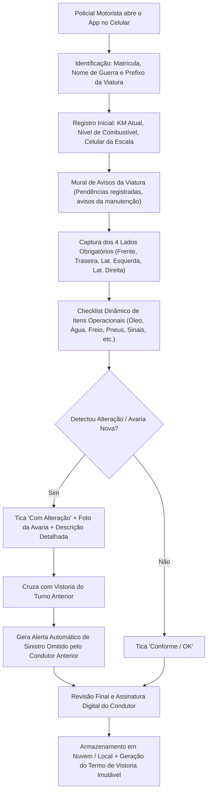
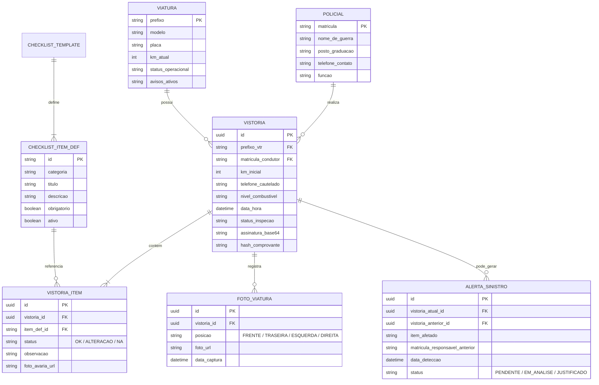

# Especificação e Arquitetura do Sistema: SisCheck-VTR
## Sistema Integrado de Vistoria, Cautela e Cadeia de Responsabilidade de Viaturas

---

### 1. Visão Geral e Objetivo Operacional
O **SisCheck-VTR** é uma solução voltada para a rotina operacional das forças de segurança pública e policiamento, resolvendo um dos maiores gargalos da gestão de frotas policiais: **a atribuição clara e tempestiva de responsabilidade sobre danos, avarias e falta de manutenção**.

A verificação ocorre **in loco** no momento da passagem e assunção do serviço policial (cautela da viatura). O motorista que assume o plantão tem total interesse e respaldo para apontar qualquer sinistro preexistente, resguardando sua equipe e responsabilizando formalmente o condutor do turno anterior que omitiu a avaria.

---

### 2. Fluxo Operacional de Assunção de Serviço (Passo a Passo)

---

### 3. Pilares Fundamentais do Aplicativo

#### A. Registro Fotográfico dos 4 Lados (Obrigatório)
No ato da inspeção, a interface guia o motorista com silhuetas/instruções para fotografar:
1. **Frente:** Placa, grade frontal, faróis, capô e para-brisa.
2. **Traseira:** Placa traseira, lanternas, tampa do porta-malas / compartimento de presos e para-choque.
3. **Lateral Esquerda:** Portas, retrovisor, pneus/rodas, vidros e adesivagem tática.
4. **Lateral Direita:** Portas, retrovisor, pneus/rodas, tampa do tanque de combustível.

> [!NOTE]
> As fotos recebem carimbo digital (Watermark) automático contendo: Prefixo da Viatura, Data/Hora sincronizada com servidor, KM informado e Matrícula do condutor.

#### B. Checklist Dinâmico e Customizável (Painel Administrativo)
Como novas avarias e necessidades surgem com frequência, o administrador pode criar ou editar itens sem necessidade de atualizar o aplicativo:
* **Mecânica & Fluidos:** Nível de óleo do motor, água do radiador, fluido de freio, bateria.
* **Sinalizadores & Elétrica:** Giroflex/barra de luzes, sirene policial e comandos de áudio, estrobos, faróis altos/baixos, luzes de freio, setas e pisca-alerta.
* **Rodagem & Acessórios:** Pressão dos pneus, estepe, macaco hidráulico, chave de roda, triângulo.
* **Compartimento e Higiene:** Limpeza interna (bancos/assoalho), compartimento de contenção de presos (cubículo/camburão), travas e cintos.
* **Comunicação & Armamento:** Rádio transceptor fixo (VHF/TETRA), suporte/trava de armas longas (fuzil/espingarda), lanterna tática acoplada.

Para cada item com alteração, o policial clica em **"Adicionar Foto da Alteração"** e detalha o ocorrido.

#### C. Cadeia de Custódia e Cruzamento de Responsabilidade
Quando um condutor finaliza o checklist com uma nova avaria:
1. O sistema busca automaticamente o **último checklist fechado para aquele prefixo**.
2. Compara se o item já havia sido apontado pelo motorista anterior.
3. Se **NÃO** constava no checklist anterior:
   - O sistema gera uma **Notificação de Avaria Não Informada**.
   - Vincula imediatamente:
     - Motorista anterior (Matrícula, Nome, Telefone da escala anterior, Data/Hora da devolução).
     - Motorista atual que identificou o sinistro.
     - Registro fotográfico do antes vs depois.
   - Fornece subsídio probatório pronto para o Encarregado de Transporte ou Corregedoria.

---

### 4. Modelo de Entidades e Banco de Dados (ERD)

---

### 5. Requisitos de Interface Mobile (In Loco)
* **Design Tático e Rápido:** Interface de alto contraste, tipografia legível sob luz solar direta, botões táteis largos (para uso até mesmo com luvas táticas).
* **Captura de Câmera Fluida:** Compactação de imagens localmente no dispositivo para não travar a memória nem onerar dados 4G/5G.
* **Modo Offline Resiliente:** Operação em áreas sem sinal de internet (batalhões remotos ou zonas rurais); sincronização automática assim que houver rede.
* **Assinatura na Tela:** O policial assina com o dedo diretamente no celular antes de submeter o checklist.
